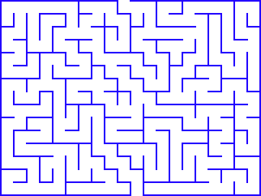
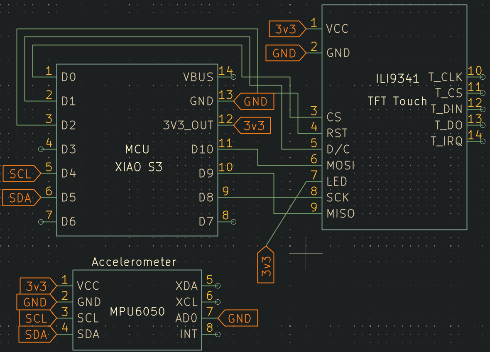

# Digital Maze Run

A small TFT ILI9341 based video game I made to mess around and learn more about displays and how to program them - ILI9341 TFT 320x240 TFT display

---

## About this project

A small maze game where you tilt the entire device to play the game. The readings are taken by an MPU6050 accelerometer and displayed on a TFT ILI9341 display.

### Currently Implemented Features:
- Wall Collisions and fixed velocity
- Move the ball based on tilt of the actual device
- Static Mazes based on image stored in flash, dynamic mazes are not implemented yet

> Image of the main maze used in the game

---

## Hardware Design

### 01 / Circuit Schematic

---

## BoM (Bill of Materials)

| Component | Quantity | Purpose |
|-----------|----------|-------------|
| Xiao ESP32 S3 | 1 | main microcontroller for processing |
| MPU6050 | 1 | Accelerometer for orientation data |
| ILI9341 TFT 320x240 | 1 | Display to show everything |

---

## Working of the software in brief

The first problem was the lack of wall data – the maze is an image, and the code needs to determine where the walls are based on this image. Since reading the display is slow, the sketch checks the same RGB565 array stored in flash. For the pixel to be considered as a wall, it should have a high blue color component and a low green component, and the conditions are sufficiently weak to include pixels with a slight anti-aliasing effect. Also, the border of the image is checked for finding the entrance to the maze in the upper wall and the exit from it in the lower one. The second challenge was avoiding passing through the walls. Since the walls have a width of 2 px, I've made the ball width 7 px and its step 2 px so it is guaranteed that no step will be longer than the wall width. The third problem was the speed. Full screen redrawing every frame is too slow and creates flickering, therefore only a few pixels near the ball are restored from the maze image at the movement. Tilt correction depends on the orientation of the device in space, which is why there are 3 flip switches available at the beginning of the program. I've tested the maze via simulation using the same wall and steps for finding its solution. This code hasn't been tested on your hardware yet.

The game logic is quite simple: every 10 ms, the code checks the tilting of the accelerometer in two directions, X and Y. The values exceeding some thresholds will result in trying to move 2px into that direction at constant velocity. Before moving, the code checks if a collision with a blue pixel will occur, so in case there is one, the ball won't move anywhere. Testing of x and y coordinates is performed independently to make the ball slide down the wall and not stuck to it. Once the ball gets into a gap in the bottom wall, the message appears: "YOU WIN!", and after three seconds, the maze is drawn again.
